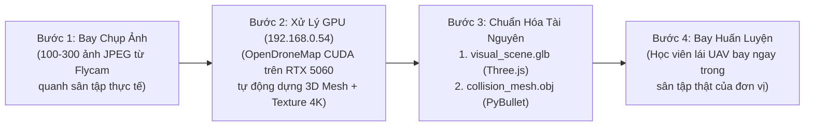

# Kiến Trúc & Lộ Trình Hệ Thống Bản Đồ 3D Thực Địa (3D Map, GIS & Drone Photogrammetry Roadmap)

Tài liệu này quy hoạch chi tiết lộ trình phát triển **Hệ thống Bản đồ 3D (3D Terrain & Photogrammetry Map Engine)** cho dự án `uav-smart-training`, kết hợp giữa trình dựng hình WebGL Three.js trên máy trạm điều khiển Windows và sức mạnh tính toán GPU **NVIDIA GeForce RTX 5060 (8GB VRAM)** trên máy chủ Ubuntu (`gazebo@192.168.0.54`).

---

## 1. Tổng Quan 3 Cấp Độ Bản Đồ 3D (3-Tier Architecture)

| Cấp độ | Tên gọi | Công nghệ lõi | Trạng thái |
|---|---|---|---|
| **Tier 1** | **Sa bàn 3D Đa bối cảnh & Radar GPS Mini-Map** | Three.js Procedural DEM Mountains + 3D Airbase (Hangar, Control Tower, Rotating Radar) + 3D Urban City + 2D SAT-NAV Radar | **ĐÃ HOÀN THÀNH (v2.0)** |
| **Tier 2** | **Bản đồ Địa lý Vệ tinh & 3D Tiles Toàn cầu (Có Cache Offline)** | `3d-tiles-renderer` (NASA AMMOS) + MapLibre DEM Terrain-RGB + OpenStreetMap 3D Buildings | **Quy hoạch Phase 2A** |
| **Tier 3** | **Tái tạo Bản đồ 3D Thực tế từ Ảnh chụp Flycam (Photogrammetry / Gaussian Splatting)** | **OpenDroneMap (ODM GPU)** / **Nerfstudio** trên máy Ubuntu RTX 5060 (`192.168.0.54`) ➔ Xuất `.glb` (Đồ họa) + `.obj` (Lưới va chạm PyBullet) | **Quy hoạch Phase 2B** |

---

## 2. Chi Tiết Kỹ Thuật Tier 2: Bản Đồ Vệ Tinh & 3D Tiles (Offline-Ready GIS)

### 2.1. Kiến trúc hiển thị (`3d-tiles-renderer`)
Các phần mềm điều khiển UAV chuyên nghiệp (như DJI FlightHub 2, QGroundControl 3D, Palantir) sử dụng chuẩn **OGC 3D Tiles** để truyền tải địa hình và tòa nhà 3D theo mức độ chi tiết (LOD - Level of Detail):
- Thư viện chuẩn: **`3d-tiles-renderer`** (do NASA AMMOS phát triển trực tiếp trên nền `Three.js`, tương thích 100% với `FlightScene3D.tsx` hiện tại mà không cần đổi sang engine khác).
- Phép chiếu tọa độ:
  - Tâm sân bay gốc (`Origin`): `LAT_0 = 21.006800° N`, `LON_0 = 105.525000° E`, `ALT_0 = 25.0m ASL` (Khu vực Hòa Lạc).
  - Chuyển đổi tọa độ phẳng cục bộ ENU (East-North-Up) của PyBullet sang tọa độ địa tâm `ECEF / WGS84`.

### 2.2. Chế độ Lưu đệm Bản đồ Offline (Offline Tile Cache)
Để đảm bảo tiêu chuẩn **chạy 100% Offline trong phòng thi sát hạch không có Internet**:
1. Xây dựng script `engine/scripts/download_region_tiles.py` tải trước vùng bản đồ bán kính $2\text{ km} \times 2\text{ km}$ quanh khu vực huấn luyện về thư mục `data/maps/tiles/{z}/{x}/{y}.png` và `terrain_dem.tif`.
2. FastAPI Backend phục vụ trực tiếp qua endpoint nội bộ `http://127.0.0.1:8000/api/maps/tiles/{z}/{x}/{y}`.

---

## 3. Chi Tiết Kỹ Thuật Tier 3: Dựng Bản Đồ 3D Sân Tập Thực Tế Bằng Máy Ubuntu RTX 5060 (`192.168.0.54`)

Đây là tính năng tạo sự khác biệt lớn nhất cho đề tài nghiên cứu và huấn luyện thực tế: **Biến khu vực sân trường / sân đơn vị ngoài đời thật thành môi trường bay 3D có va chạm vật lý chuẩn xác đến từng centimet**.

### 3.1. Quy trình 4 Bước (End-to-End Photogrammetry Pipeline)



### 3.2. Các lệnh triển khai trên Máy Trạm Ubuntu GPU (`192.168.0.54`)

Khi có bộ ảnh chụp từ trên cao (hoặc bộ ảnh mẫu), chạy lệnh sau từ máy Windows qua SSH tới `gazebo@192.168.0.54`:

```bash
# 1. Tạo thư mục chứa ảnh bay chụp trên máy Ubuntu GPU
ssh gazebo@192.168.0.54 "mkdir -p ~/uav-maps/san_tap_01/images"

# 2. Copy bộ ảnh JPEG từ máy Windows sang máy Ubuntu
scp D:\anh_flycam\*.JPG gazebo@192.168.0.54:~/uav-maps/san_tap_01/images/

# 3. Chạy OpenDroneMap (ODM) tăng tốc bằng GPU NVIDIA RTX 5060
ssh gazebo@192.168.0.54 "docker run -ti --rm --gpus all \
  -v ~/uav-maps/san_tap_01:/datasets/code \
  opendronemap/odm:gpu --project-path /datasets \
  --mesh-octree-depth 11 --mesh-size 200000 --gltf"
```

### 3.3. Nạp Bản đồ Thực tế vào PyBullet (Vật lý) & Three.js (Đồ họa)

Sau khi máy Ubuntu xuất ra `odm_textured_model_geo.glb` và `odm_mesh.obj`:
1. **Trên giao diện 3D (`app/public/models/maps/san_tap_01.glb`)**:
   - `GLTFLoader` của Three.js nạp trực tiếp mô hình 3D thực tế có phủ ảnh chụp 4K sắc nét.
2. **Trên lõi vật lý (`engine/uavsim/vehicle/pybullet_vehicle.py`)**:
   - Nạp lưới va chạm địa hình thực vào PyBullet bằng hàm:
   ```python
   terrain_col_id = p.createCollisionShape(
       shapeType=p.GEOM_MESH,
       fileName="data/maps/san_tap_01/collision_mesh.obj",
       flags=p.GEOM_FORCE_CONCAVE_TRIMESH,
       physicsClientId=self.client_id,
   )
   p.createMultiBody(baseMass=0, baseCollisionShapeIndex=terrain_col_id, physicsClientId=self.client_id)
   ```
   - Nhờ đó, khi học viên bay chạm vào mái nhà thật, ngọn cây thật hay địa hình đồi dốc thật trong bản đồ, PyBullet sẽ phát hiện va chạm chính xác 100%!


---

## 4. Tài Liệu Hướng Dẫn Chi Tiết: Dựng Bản Đồ Khuôn Viên Nhà Trường (Campus Digital Twin)

Xem hướng dẫn chuyên sâu chi tiết về quy trình dựng 3D, kỹ thuật bay chụp flycam chéo góc (oblique) và thiết kế bài bay khuôn viên trường học tại:
👉 **[Hướng Dẫn Dựng Bản Đồ 3D Khuôn Viên Nhà Trường (CUSTOM_CAMPUS_3D_MAP_GUIDE.md)](file:///d:/10.VAN_HAO/2.UAV_SMART/uav-smart-training/docs/CUSTOM_CAMPUS_3D_MAP_GUIDE.md)**
