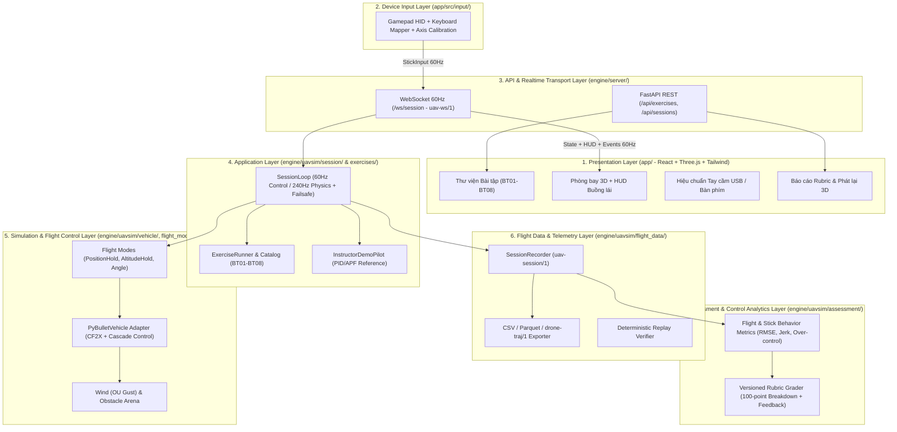

# Kiến trúc Hệ thống (System Architecture) — UAV Smart Training

## 1. Kiến trúc 7 lớp theo `Outline.docx`

Hệ thống tuân thủ nghiêm ngặt nguyên tắc phân tách trách nhiệm (Separation of Concerns) với 7 lớp kiến trúc rõ ràng:

## 2. Quy tắc hướng phụ thuộc (Dependency Direction)
- `domain` không phụ thuộc bất kỳ module nào khác (chỉ dùng thư viện chuẩn và `pydantic`/`dataclasses`).
- `vehicle`, `flight_modes`, `environment` chỉ phụ thuộc `domain` và `gym-pybullet-drones`/`numpy`. Tuyệt đối không biết về WebSocket, UI hay Rubric.
- `exercises`, `flight_data`, `assessment` phụ thuộc `domain`.
- `session` điều phối `vehicle`, `flight_modes`, `environment`, `exercises`, `flight_data`, `assessment`.
- `server` bọc `session` qua FastAPI REST & WebSocket.

## 3. Tách biệt xung nhịp Vật lý (240Hz) và Hiển thị (60 FPS)
- Mỗi bước điều khiển (`dt_ctrl = 1/60 s ≈ 16.67 ms`) thực hiện chính xác **4 bước con vật lý PyBullet** (`dt_pyb = 1/240 s ≈ 4.17 ms`).
- Tốc độ mô phỏng vật lý được giữ đồng bộ với đồng hồ thời gian thực (`time.perf_counter()`) khi học viên bay trực tiếp, hoặc chạy tối đa tốc độ CPU (>1.000 bước/giây) khi kiểm thử tự động / tạo quỹ đạo mẫu.

## 4. Mở rộng Kiến trúc Lai (Hybrid) với Trạm Ubuntu GPU (`192.168.0.54`)
Chi tiết thiết kế mở rộng hai chế độ mô phỏng (PyBullet cục bộ vs. ArduPilot SITL / Gazebo từ xa qua MAVLink UDP `14550`) và quy trình huấn luyện AI trên card đồ họa NVIDIA RTX 5060 được lưu trữ đầy đủ tại:
👉 [`docs/UBUNTU_GPU_INTEGRATION_PLAN.md`](UBUNTU_GPU_INTEGRATION_PLAN.md).
