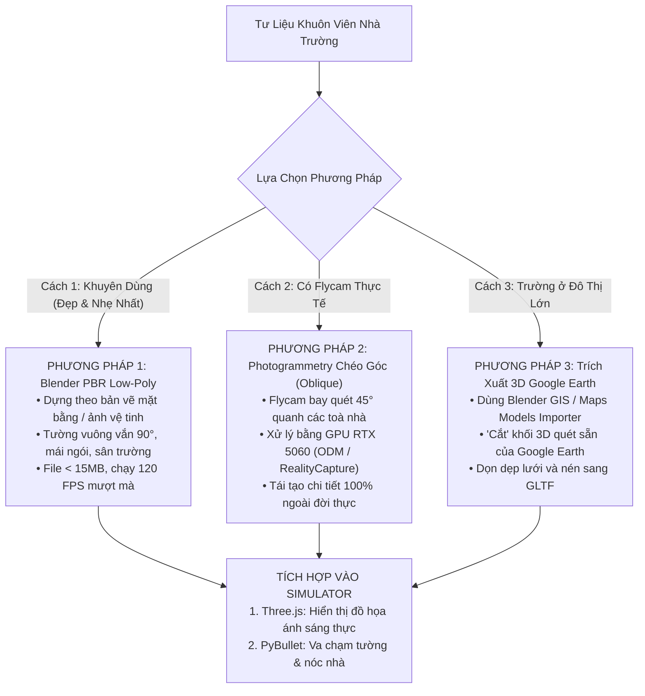

# Hướng Dẫn & Lộ Trình Kỹ Thuật: Dựng Bản Đồ 3D Riêng Biệt Cho Khuôn Viên Nhà Trường (Campus Digital Twin)

> **Mục tiêu**: Xây dựng một bản đồ 3D thực tế, chuẩn xác và mang tính nhận diện cao cho chính **Khuôn viên Nhà trường / Đơn vị** của anh. Thay vì các khối hộp thuật toán ngẫu nhiên, học viên sẽ được bay luyện tập trên đúng sân trường, giảng đường, cột cờ, cổng chính và sân vận động quen thuộc với đồ họa PBR sắc nét và va chạm vật lý PyBullet chân thực 100%.

---

## 1. Tại Sao Cần Bản Đồ Digital Twin Riêng Cho Nhà Trường?

Qua thử nghiệm thực tế:
1. **Khối hộp vệ tinh sinh ngẫu nhiên (Procedural Blocks)**: Tuy có chiều sâu không gian nhưng chỉ là các khối bê tông hộp chữ nhật lặp lại, không có kiến trúc đặc trưng của trường học (mái ngói đỏ, hành lang lớp học, sân chào cờ, cổng trường, hàng cây).
2. **Ảnh vệ tinh phẳng 2D (Flat Orthophoto)**: Mặt đất bị phẳng lì, không tạo được cảm giác bay luồn lách giữa các tòa nhà và không thể hạ cánh trên nóc nhà.
3. **Mô hình Photogrammetry tự động từ flycam chỉ chụp từ trên cao (Nadir)**: Tường bị kéo dốc nham nhở, hiệu ứng sáp chảy biến dạng.

**Giải pháp tối ưu**: Dựng **Mô hình 3D Digital Twin Chuyên Biệt (Custom Campus 3D Model)** xuất định dạng chuẩn `.glb` được tối ưu hóa cho WebGL Three.js và đồng bộ va chạm với PyBullet.

---

## 2. 3 Phương Pháp Triển Khai Dựng Bản Đồ Nhà Trường

Tùy thuộc vào tư liệu anh có (ảnh chụp flycam, ảnh điện thoại, hay bản vẽ mặt bằng), chúng ta có 3 phương pháp từ dễ đến chuyên sâu:



---

### Phương Pháp 1: Dựng Kiến Trúc Low-Poly PBR Trong Blender (Khuyên dùng - Đẹp & Tối ưu nhất)

*Đây là cách mà các tựa game mô phỏng huấn luyện hàng không chuyên nghiệp (Microsoft Flight Simulator, RealFlight, Uncrashed) áp dụng cho các sân bay và trường bắn.*

1. **Thu thập dữ liệu cơ sở**:
   - Ảnh chụp từ trên cao (từ Google Maps hoặc ảnh chụp toàn cảnh flycam) làm ảnh lót đáy tỉ lệ $1:1$.
   - Ảnh chụp thực tế mặt trước các dãy nhà: Nhà hiệu bộ, các dãy giảng đường A, B, C, cổng chính, thư viện, nhà thi đấu/sân bóng.
2. **Dựng hình học trong Blender**:
   - Kéo khối các tòa nhà theo đúng kích thước thực tế (chiều rộng, dài, cao số tầng).
   - Dựng mái nhà phẳng có gờ lan can (dùng làm bãi đáp flycam) hoặc mái ngói dốc đặc trưng.
   - Thêm các chi tiết cảnh quan nhận diện:
     - **Cổng trường & Biển tên trường**: Điểm mốc trực quan ngay khi cất cánh.
     - **Sân chào cờ & Cột cờ**: Bãi đáp xuất phát (Home Takeoff Pad).
     - **Sân bóng đá cỏ xanh / Sân bóng rổ / Đường chạy điền kinh**: Khu vực không gian mở để luyện bài bay số 8 và hình tròn.
     - **Hàng cây xanh và cột đèn chiếu sáng**: Đóng vai trò là vật cản huấn luyện tránh va chạm.
3. **Vật liệu PBR thực tế**:
   - Tường sơn vàng/trắng đặc trưng trường học Việt Nam.
   - Kính cửa sổ phản chiếu ánh nắng bầu trời thời gian thực.
   - Sân bê tông có vạch sơn phân làn, bãi đỗ xe và sân cỏ xanh mát.
4. **Ưu điểm vượt trội**:
   - Dung lượng siêu nhẹ (chỉ khoảng $10 - 20\text{ MB}$).
   - Tường phẳng tuyệt đối $90^\circ$, không bao giờ bị móp méo hay nham nhở.
   - Tốc độ khung hình đạt **120 FPS** mượt mà trên mọi máy tính.

---

### Phương Pháp 2: Bay Flycam Chụp Chéo Góc (Oblique Photogrammetry) + Xử Lý Bằng GPU RTX 5060

*Áp dụng khi nhà trường có sẵn flycam (Mavic 3, Air 3, Phantom 4 Pro) và muốn quét số hóa 3D tự động.*

1. **Quy tắc bay chụp bắt buộc (Khắc phục triệt để lỗi sáp chảy của ODM cũ)**:
   - **Tuyệt đối KHÔNG CHỈ chụp thẳng đứng $90^\circ$ (Nadir)**: Chụp thẳng đứng là nguyên nhân khiến tường bị mất và kéo dốc nham nhở.
   - **Kỹ thuật chụp 3 tầng**:
     - *Tầng 1 (Nadir $90^\circ$)*: 80 - 100 ảnh ở độ cao $60\text{m}$ để lấy toàn cảnh mặt sân và nóc nhà.
     - *Tầng 2 (Oblique chéo $45^\circ$)*: 120 ảnh ở độ cao $35 - 40\text{m}$ bay theo hình lưới ziczac nhìn chéo để lấy toàn bộ mặt tường, cửa sổ và mái hiên.
     - *Tầng 3 (Orbit quay tròn)*: Bay vòng tròn quanh Nhà hiệu bộ và Cổng trường ở góc nghiêng $30^\circ - 45^\circ$.
2. **Xử lý trên Máy chủ GPU NVIDIA RTX 5060 (`192.168.0.54`)**:
   - Sử dụng **RealityCapture** hoặc **OpenDroneMap (ODM) GPU** để tái tạo Point Cloud và lưới tam giác 3D.
   - Xuất file mô hình `school_raw.glb`.
3. **Hậu kỳ Blender (Decimation & Retopology)**:
   - Dùng lệnh `Decimate` giảm số tam giác từ 2 triệu polygon xuống còn 80.000 - 150.000 polygon để trình duyệt render nhẹ nhàng.
   - Nướng texture (Bake Texture) sang 1 file ảnh $4\text{K}$.

---

### Phương Pháp 3: Trích Xuất Mô Hình 3D Từ Google Earth (Blender GIS)

*Áp dụng nếu khu vực nhà trường của anh nằm trong vùng phủ sóng 3D Mesh của Google Earth / Google Maps 3D.*

1. Dùng Blender kết hợp công cụ **Maps Models Importer** và **RenderDoc**.
2. "Cắt" trọn vẹn khối 3D thực tế của khu vực khuôn viên trường học từ Google Earth.
3. Xuất ra file `.glb` đã bao gồm toàn bộ nhà cửa, cây cối và mặt đường nguyên bản từ vệ tinh Google.

---

## 3. Kiến Trúc Tích Hợp Vào UAV Smart Simulator

Khi file mô hình 3D khuôn viên trường (`school_campus.glb`) hoàn thành, quy trình nạp vào mã nguồn diễn ra như sau:

```
uav-smart-training/
├── app/
│   ├── public/
│   │   └── models/
│   │       └── maps/
│   │           ├── school_campus.glb       <-- File đồ họa 3D hiển thị (Three.js)
│   │           └── school_collision.obj    <-- File lưới va chạm vật lý (PyBullet)
│   └── src/
│       └── scene/
│           └── FlightScene3D.tsx           <-- Tự động nạp qua MapPreset "school_campus"
└── engine/
    └── config/
        └── catalog.yaml                    <-- Đăng ký tọa độ xuất phát và bài tập trường
```

### 1. Phía Đồ Họa (Three.js WebGL Frontend):
- Thêm preset `"school_campus"` vào danh sách bản đồ.
- Tự động nạp `school_campus.glb` qua `GLTFLoader`.
- Bật bóng đổ mềm thời gian thực (PCFSoftShadowMap), ánh sáng mặt trời theo hướng thực tế và phản chiếu môi trường bầu trời xanh.

### 2. Phía Vật Lý (PyBullet Simulation Backend):
- Nạp file `school_collision.obj` thành vật cản tĩnh (`GEOM_MESH` hoặc danh sách `GEOM_BOX`).
- Drone va vào tường giảng đường sẽ nảy ra và báo còi cảnh báo; hạ cánh trên sân chào cờ hoặc nóc nhà sẽ đứng vững chắc trên mặt sàn phẳng.

---

## 4. Các Bài Bay Thực Địa Chuyên Sâu Dành Riêng Cho Nhà Trường

Khi có bản đồ nhà trường, chúng ta có thể thiết kế các bài tập vô cùng sinh động và ý nghĩa:

| Mã Bài | Tên Bài Huấn Luyện | Điểm Xuất Phát & Lộ Trình | Kỹ Năng Rèn Luyện |
|---|---|---|---|
| **BT-TR01** | **Cất Cánh Sân Chào Cờ & Khảo Sát Cổng Trường** | Xuất phát tại vòng tròn sân cờ $\rightarrow$ Bay qua lễ đài $\rightarrow$ Lượn qua cổng chính $\rightarrow$ Quay về đáp | Giữ hướng đầu bay (Heading), kiểm soát độ cao tầm thấp qua cổng. |
| **BT-TR02** | **Bay Luồn Lách Hẻm Giữa Các Dãy Giảng Đường** | Cất cánh sân trường $\rightarrow$ Luồn qua khe hẹp giữa dãy nhà A và B $\rightarrow$ Tránh hàng cây | Kiểm soát trôi dạt (Drift) do hiệu ứng gió hút giữa hai bức tường. |
| **BT-TR03** | **Tuần Tra Toàn Cảnh Sân Vận Động & Khán Đài** | Bay quanh đường chạy điền kinh $\rightarrow$ Lượn hình số 8 qua 2 cột khung thành | Điều phối mượt mà cả 4 trục Ga - Xoay - Tiến - Nghiêng (Coordinated Turn). |
| **BT-TR04** | **Hạ Cánh Khẩn Cấp Trên Sân Thượng Nhà Hiệu Bộ** | Cất cánh từ mặt đất $\rightarrow$ Bay lên độ cao tầng 5 $\rightarrow$ Tìm bãi đáp Helipad nóc nhà $\rightarrow$ Đáp êm | Kỹ năng tiếp đất nóc nhà trong điều kiện gió giật tầng cao. |

---

## 5. Danh Mục Chuẩn Bị (Checklist Khi Anh Sẵn Sàng Triển Khai)

Khi nào anh muốn bắt tay vào dựng map nhà trường, anh chỉ cần chuẩn bị giúp em:
- [ ] **Tên trường và Tọa độ GPS** (hoặc link vị trí trên Google Maps).
- [ ] **Một vài bức ảnh chụp tổng thể khuôn viên trường**:
  - Ảnh mặt đứng các dãy nhà chính (nhà hiệu bộ, các dãy phòng học).
  - Ảnh cổng trường và sân chào cờ.
  - (Nếu có) Ảnh chụp bằng flycam từ trên cao nhìn xuống toàn cảnh.
- [ ] **(Tùy chọn) Bản vẽ mặt bằng tổng thể** (nếu nhà trường có sơ đồ quy hoạch khuôn viên).

Từ các tư liệu này, em sẽ hỗ trợ anh dựng mô hình 3D Digital Twin chuẩn tỉ lệ từng mét, nạp vào hệ thống để anh và học viên có thể cắm tay cầm **RadioMaster Pocket** bay lượn ngay trên trường của mình!
