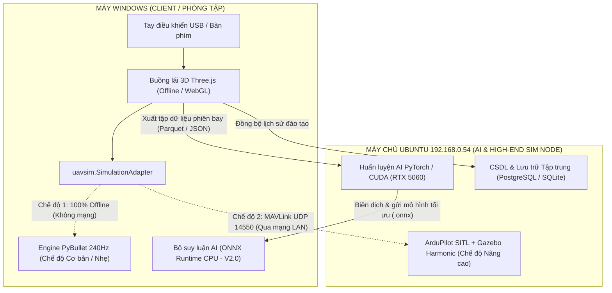

# Hướng dẫn Kỹ thuật: Tận dụng Trạm Ubuntu GPU (RTX 5060) cho Hệ thống UAV Smart Training

Tài liệu này ghi lại toàn bộ **các mốc tiến độ đã hoàn thành** của dự án và **bản thiết kế kỹ thuật chi tiết** để tận dụng trạm máy tính Ubuntu GPU rời (`192.168.0.54`) phục vụ cho các giai đoạn phát triển nâng cao (Huấn luyện AI chuyên sâu, Mô phỏng ArduPilot SITL chuẩn công nghiệp và Máy chủ Đào tạo tập trung).

---

## PHẦN I: NHẬT KÝ CÁC MỐC TIẾN ĐỘ ĐÃ HOÀN THÀNH

| Mốc | Tên hạng mục | Trạng thái | Chi tiết kỹ thuật & Kết quả nghiệm thu |
|---|---|---|---|
| **M0** | Khảo sát Mã nguồn & Audit Repo cũ | **Hoàn thành** | Đọc toàn bộ `Outline.docx`, `Nghiên cứu mã nguồn mở.txt` và `drone-rl-lab`. Đánh giá 4 repo (`gym-pybullet-drones` ADOPT, `RC-Flight-Sim` REJECT, `Sky-Sim 3.0` REFERENCE, `RotorPy` REFERENCE). |
| **M1** | Chuyển dịch Trọng tâm Bài toán | **Hoàn thành** | Phân định rõ bài toán: chuyển từ "dạy AI tự bay bằng PPO" sang **"phần mềm cho học viên con người luyện tập lái UAV qua tay cầm USB/bàn phím"**. |
| **M2** | Thiết lập Dự án Độc lập `uav-smart-training` | **Hoàn thành** | Tạo thư mục độc lập `D:\10.VAN_HAO\2.UAV_SMART\uav-smart-training`, dọn dẹp các thư mục thư viện nặng ở repo cũ (`.venv`, `node_modules`). Xây dựng môi trường Python 3.12 + PyBullet 240Hz dựng sẵn bằng Micromamba + UV. |
| **M3** | Bộ Lõi Vật lý & 3 Chế độ Bay Huấn luyện | **Hoàn thành** | Xây dựng `PyBulletVehicle`, bộ điều khiển đa chế độ: `position_hold` (Giữ vị trí), `altitude_hold` (Giữ độ cao), `angle` (Tự cân bằng ga trực tiếp), và cơ chế an toàn `failsafe` (tự giữ vị trí & hạ cánh khi ngắt kết nối >0.5s). |
| **M4** | Giáo trình Bài tập Chuẩn hóa BT01–BT08 | **Hoàn thành** | Nạp từ `catalog.yaml`, kiểm tra tiến độ thời gian thực (`ExerciseRunner`), tích hợp **Phi công Mẫu AI/PID (Instructor Demo)** né cột bằng trường thế nhân tạo APF. |
| **M5** | Telemetry `uav-session/1` & Chấm điểm Rubric | **Hoàn thành** | Ghi nhận 60Hz, xuất CSV / Parquet / `drone-traj/1`. Kiểm chứng phát lại tất định (Deterministic Replay) sai số $< 10^{-6}\text{ m}$. Chấm điểm Rubric 100 điểm kèm chẩn đoán lỗi thao tác (Over-control, Jerk). |
| **M6** | Giao diện Buồng lái 3D Offline | **Hoàn thành** | Ứng dụng React + Vite + Tailwind + Three.js 100% Offline; HUD buồng lái; nhận diện Gamepad USB (Mode 2 / Mode 1) + hiệu chuẩn trục + bàn phím dự phòng; 3 góc nhìn camera; thanh trượt phát lại 3D. Đã kiểm thử `9/9 pytest pass`, benchmark đạt **3.448 bước/s (gấp 57 lần thời gian thực)**, Vite build thành công. |

---

## PHẦN II: THÔNG TIN PHẦN CỨNG & PHẦN MỀM MÁY CHỦ UBUNTU GPU

### 1. Thông số Phần cứng & Kết nối Mạng
- **Địa chỉ IP trong LAN**: `192.168.0.54` (cổng SSH `22`, cổng MAVLink `14550`)
- **Tên máy (Hostname)**: `Gazebo-SITL`
- **Tài khoản SSH**: `gazebo`
- **Khóa xác thực (SSH Key)**: Đã tích hợp khóa công khai từ máy Windows tại:
  `C:\Users\Admin\.ssh\id_ed25519.pub` → `gazebo@192.168.0.54:~/.ssh/authorized_keys`
  *(Có thể truy cập trực tiếp từ PowerShell không cần gõ mật khẩu bằng lệnh: `ssh gazebo@192.168.0.54`)*.
- **Hệ điều hành**: **Ubuntu 24.04.1 LTS** (Linux kernel 7.0 / 6.8 SMP PREEMPT_DYNAMIC)
- **Card đồ họa (GPU)**: **NVIDIA GeForce RTX 5060 (8GB VRAM / 8151 MiB)**
- **Driver NVIDIA**: `595.99.02` (Hỗ trợ đầy đủ CUDA 12.x, TensorRT, PyTorch GPU)

### 2. Các Hệ thống Đã Cài đặt Sẵn trên Máy Ubuntu
1. **ArduPilot Firmware**: Thư mục `/home/gazebo/ardupilot` (mã nguồn ArduCopter và các công cụ SITL).
2. **Gazebo Harmonic Engine**: Phiên bản `/usr/bin/gz` thế hệ mới nhất của Open Robotics.
3. **Plugin Liên kết `ardupilot_gazebo`**: Đã biên dịch tại `/home/gazebo/ardupilot_gazebo/build`.
4. **Mô phỏng Môi trường `Gazebo-Harmonic-drone-SITL`**: Thư mục `/home/gazebo/Gazebo-Harmonic-drone-SITL`.
5. **Môi trường Python ArduPilot**: `/home/gazebo/venv-ardupilot`.
6. **Trạm Mặt đất TCU Ground Control**: `/home/gazebo/TCUGroundControl` (QGroundControl tùy biến).
7. **Kịch bản Khởi chạy Sẵn**: `/home/gazebo/run_uav_sitl.sh` (mở mô phỏng và stream MAVLink về IP chỉ định).

---

## PHẦN III: KIẾN TRÚC PHỐI HỢP CHIẾN LƯỢC (HYBRID ARCHITECTURE)

Do máy tính Windows của người dùng chỉ có GPU tích hợp (Intel Iris Xe) nhưng máy Ubuntu lại sở hữu GPU chuyên dụng mạnh mẽ (RTX 5060 8GB), kiến trúc tối ưu nhất là mô hình **Hybrid Client-Server**:



---

## PHẦN IV: KẾ HOẠCH HÀNH ĐỘNG CHI TIẾT TẬN DỤNG MÁY UBUNTU

### 1. Trụ cột A: Huấn luyện Mô hình AI Đánh giá Lỗi Thao tác (AI Training Node)
- **Vấn đề**: Máy Windows không có nhân CUDA, việc huấn luyện mạng nơ-ron nhận diện hành vi (TCN, LSTM, Transformer phân loại thói quen lắc cần, giật cần, trôi gió) hoặc Deep Reinforcement Learning sẽ rất chậm.
- **Giải pháp**:
  1. Khi học viên bay trên máy Windows, telemetry được lưu tự động thành file bảng cột `frames.parquet` trong thư mục `data/sessions/`.
  2. Gửi tập dữ liệu sang máy Ubuntu qua SSH/SCP:
     ```powershell
     scp D:\10.VAN_HAO\2.UAV_SMART\uav-smart-training\data\sessions\*.parquet gazebo@192.168.0.54:~/uav_training_dataset/
     ```
  3. Huấn luyện mô hình trên GPU RTX 5060 (tận dụng CUDA và Tensor Cores để train cực nhanh trong vài phút).
  4. Xuất mô hình đã train thành định dạng chuẩn **ONNX**:
     `model_pilot_behavior.onnx`.
  5. Chép file `.onnx` ngược về máy Windows đặt vào `engine/uavsim/assessment/models/`. App Windows sẽ dùng `onnxruntime` (chạy trên CPU i7-1360P chỉ mất $< 2\text{ ms}$ cho mỗi lượt suy luận) để chấm điểm lỗi thời gian thực mà **không cần GPU rời trên Windows**!

---

### 2. Trụ cột B: Tích hợp Chế độ Bay Nâng cao ArduPilot SITL qua MAVLink
- **Vấn đề**: `Outline.docx` yêu cầu khảo sát ArduPilot SITL, nhưng ArduPilot và Gazebo rất cồng kềnh nếu ép cài trên Windows.
- **Giải pháp**:
  - Tầng `PyBulletVehicle` trong mã nguồn hiện tại được bọc bởi interface trừu tượng `SimulationAdapter`.
  - Chúng ta sẽ bổ sung thêm một adapter thứ hai: `ArduPilotMAVLinkVehicle`.
  - Khi người dùng chọn chế độ:
    - **"Mô phỏng Độc lập (PyBullet)"**: Chạy hoàn toàn trên máy Windows (mang laptop đi bất kỳ đâu không cần Wi-Fi/mạng).
    - **"Mô phỏng Chuyên sâu (ArduPilot SITL)"**: App Windows kết nối qua socket MAVLink UDP tới `192.168.0.54:14550`.
  - Trên máy Ubuntu, khởi chạy kịch bản SITL có sẵn:
    ```bash
    ssh gazebo@192.168.0.54
    ./run_uav_sitl.sh
    ```
  - Tín hiệu tay cầm từ trình duyệt Windows (`StickInput`) sẽ được chuyển đổi thành lệnh MAVLink `RC_CHANNELS_OVERRIDE` (hoặc `SET_ATTITUDE_TARGET`) gửi sang Ubuntu; trạng thái máy bay thật từ EKF của ArduPilot sẽ truyền ngược về để Three.js hiển thị trên màn hình học viên.

---

### 3. Trụ cột C: Máy chủ Lưu trữ & Báo cáo Đào tạo Tập trung
- Khi triển khai phòng thực hành có nhiều máy tính học viên (Client 1, Client 2, Client 3...), máy Ubuntu `192.168.0.54` sẽ chạy FastAPI Backend đóng vai trò **Máy chủ Quản trị**:
  - Tập hợp toàn bộ danh sách học viên, lớp học.
  - Tự động nhận kết quả phiên bay từ các máy con gửi về để giảng viên mở trạm kiểm tra và phê duyệt kết quả.

---

## PHẦN V: HƯỚNG DẪN LỆNH THAO TÁC NHANH (CHEATSHEET)

### 1. Kiểm tra trạng thái máy Ubuntu từ Windows PowerShell
```powershell
# Kiểm tra kết nối mạng
Test-NetConnection -ComputerName 192.168.0.54 -Port 22

# Kiểm tra tình trạng GPU RTX 5060 và tài nguyên
ssh gazebo@192.168.0.54 "nvidia-smi; free -h; df -h"
```

### 2. Bật mô phỏng ArduPilot SITL từ xa khi cần kiểm tra MAVLink
```powershell
ssh gazebo@192.168.0.54 "bash -lc './run_uav_sitl.sh'"
```

### 3. Tắt sạch các tiến trình mô phỏng trên máy Ubuntu
```powershell
ssh gazebo@192.168.0.54 "bash -lc './kill_all_sim.sh'"
```

---

## PHẦN VI: KẾT LUẬN & ĐỊNH HƯỚNG BƯỚC ĐI TIẾP THEO

1. **Giai đoạn Hiện tại (V1.0)**:
   - Tiếp tục hoàn thiện app Windows độc lập (Âm thanh động cơ Web Audio, Drone Dẫn đường Ghost Drone, Lưu trữ SQLite cục bộ và Báo cáo in ấn). Điều này đảm bảo sản phẩm cốt lõi gọn nhẹ, tự lực và hoạt động hoàn hảo trên máy cá nhân của anh.
2. **Giai đoạn Kế tiếp (V1.5 & V2.0)**:
   - Mở tài liệu này ra và thực hiện việc kết nối MAVLink UDP `14550` tới máy Ubuntu để mở rộng bài bay ArduPilot chuyên sâu.
   - Sử dụng GPU RTX 5060 của máy Ubuntu làm nơi huấn luyện mô hình học máy (AI Training) và xuất file ONNX về máy Windows.
