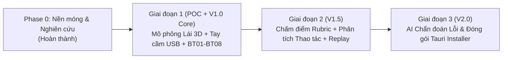

# Lộ trình Phát triển Hệ thống (Development Roadmap)

## 1. Phase 0 — Nền móng & Khảo sát Mã nguồn mở
- Hoàn thiện bộ 6 tài liệu nghiên cứu và quyết định kiến trúc.
- Thiết lập môi trường Python 3.12 + `pybullet 3.25` dựng sẵn + `gym-pybullet-drones` độc lập trong `uav-smart-training/engine/.venv`.

## 2. Giai đoạn 1 (POC & Core V1.0) — Lái UAV 3D Thời gian thực & Giáo trình BT01–BT08
- Xây dựng `PyBulletVehicle` + 3 chế độ bay (`position_hold`, `altitude_hold`, `angle`) + cơ chế `Failsafe` 0.5s.
- Xây dựng đầy đủ 8 bài tập chuẩn hóa **BT01 → BT08** kèm **Phi công mẫu (Instructor Demo)**.
- Xây dựng giao diện 3D Three.js Offline với HUD buồng lái, nhận diện Tay cầm USB (Gamepad API Mode 2 / Mode 1) + Hiệu chuẩn trục + Bàn phím dự phòng.

## 3. Giai đoạn 2 (V1.5 Core) — Chấm điểm Định lượng Rubric & Phát lại Phiên bay
- Ghi nhận phiên bay theo schema `uav-session/1`, hỗ trợ xuất CSV, Parquet và `drone-traj/1`.
- Chấm điểm tự động theo thang 100 điểm (Độ chính xác 40đ, Hoàn thành 25đ, Kỹ năng thao tác cần 20đ, An toàn 15đ).
- Phân tích hành vi điều khiển (độ giật cần `stick_jerk`, chỉ số chỉnh quá mức `overcontrol_index`, phản ứng gió giật) và phát lại 3D đối chiếu với quỹ đạo chuẩn.

## 4. Giai đoạn 3 (V2.0 Mở rộng) — Huấn luyện AI Chuyên sâu & Đóng gói Bộ cài Tauri
- Thu thập tập dữ liệu phiên bay thực tế của học viên có nhãn giảng viên để huấn luyện mô hình TCN/LSTM (ONNX Runtime) phân loại thói quen điều khiển.
- Đóng gói toàn bộ Python Engine (PyInstaller sidecar) và Frontend vào bộ cài đặt Windows `.msi`/`.exe` qua Tauri 2.
